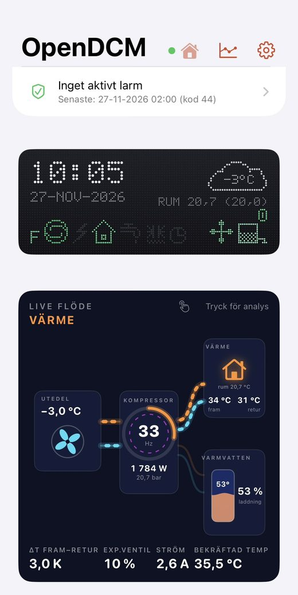
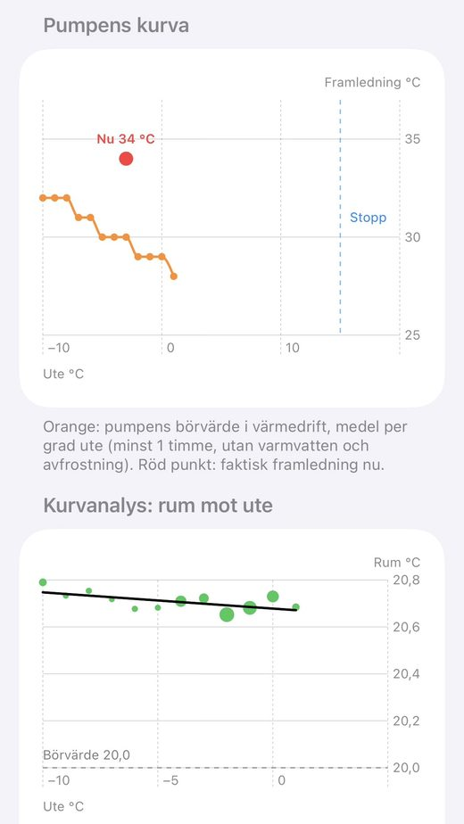
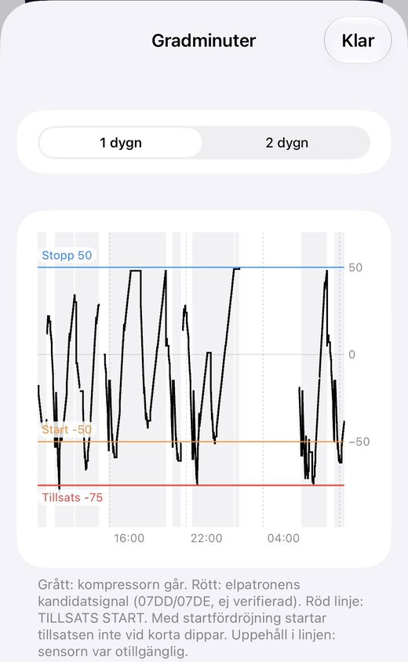
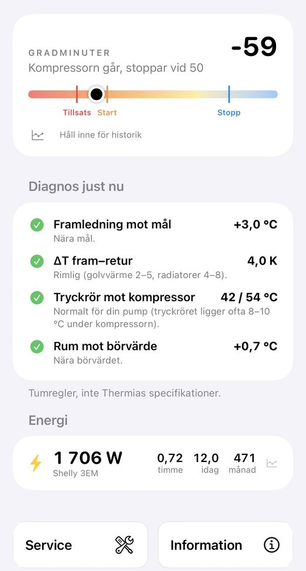
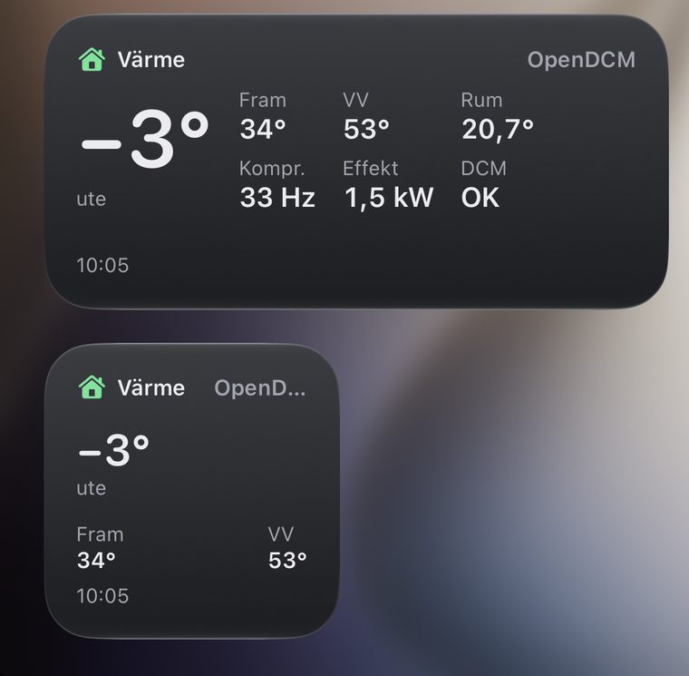
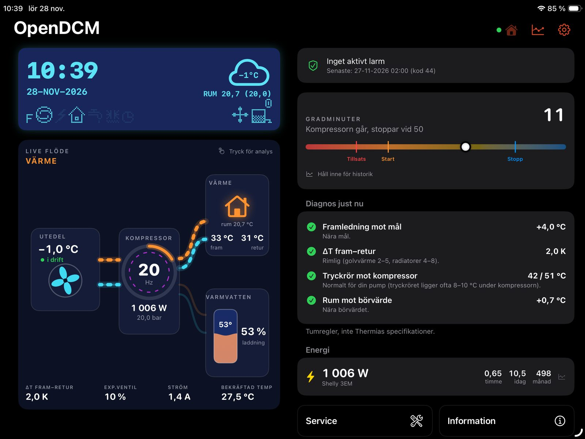
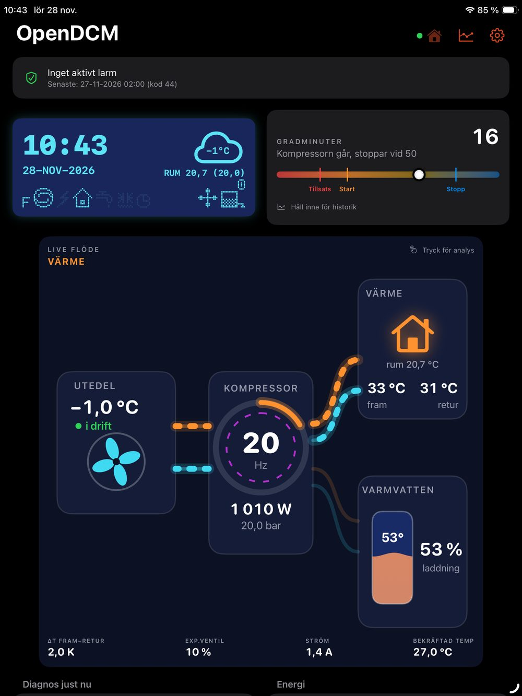
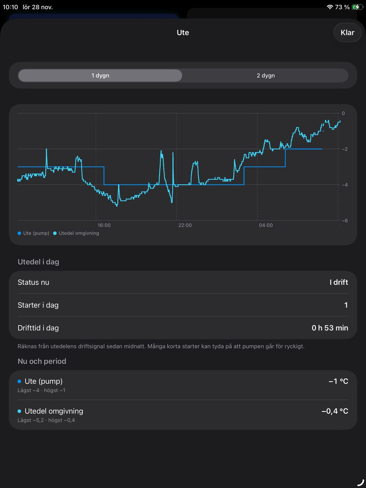

# OpenDCM

An open-source, **read-only** iPhone and iPad app for Thermia iTec heat pumps, built with SwiftUI. It shows live data from your own Home Assistant: a flow diagram, history charts and the pump's menus.

OpenDCM is **not affiliated with, endorsed by or connected to Thermia**. It does not use Thermia's name, graphics or cloud service.

> **Work in progress.** The app runs daily on my own iPhone and iPad against a Thermia iTec XT10. The source code will be published here once it is cleaned up for other installations.

## What it looks like

| Overview | Heating curve | Degree minutes |
|---|---|---|
|  |  |  |

| Diagnosis and energy | Home screen widget |
|---|---|
|  |  |

### iPad

On iPad the overview uses two columns in landscape, with the display and the whole flow diagram visible without scrolling, and a stacked layout in portrait.



| Portrait | Outdoor unit today |
|---|---|
|  |  |

The app is in Swedish for now. English is on the roadmap.

## Working today

- **Live display**: a dot-matrix status panel with clock, outdoor and room temperature and the pump's status symbols (compressor, heating, hot water, defrost, fan, tank level), in three styles: OpenDCM's own graphite and green, a classic blue and a retro amber LCD. While hot water is produced the tank fills from the bottom up.
- **Live flow diagram**: animated outdoor unit, compressor, heating circuit and hot-water tank, with flow direction reversed during defrost.
- **Heating curve analysis**: the pump's actual supply setpoint per outdoor degree, plus room versus outdoor temperature, to tell whether the curve slope or a parallel offset needs adjusting.
- **Degree minutes**: history with start, stop and auxiliary heat limits, compressor runs and defrosts.
- **Diagnosis**: rule-of-thumb checks of supply versus target, ΔT, discharge pipe and room temperature.
- **Menus**: Information and Service, mirroring the pump's own menu structure. Read-only.
- **Alarms**: active alarm and alarm history.
- **Outdoor unit**: running status from the unit's own run signal, plus starts and run time today.
- **iPad layout**: two columns in landscape, stacked in portrait, larger charts.
- **Widget**: home screen and lock screen widget with operating mode and key values.

## How it works

```
Thermia iTec
   |  RS485
ESP32 (ESPHome)
   |  API
Home Assistant
   |  REST / WebSocket
OpenDCM
```

The app never talks to the pump. It only reads entities from Home Assistant. The firmware that exposes the pump data is a separate project: [thermia-itec-dcm-esphome](https://github.com/Korsberg/thermia-itec-dcm-esphome).

## Status

Early development. Read-only. See [docs/ROADMAP.md](docs/ROADMAP.md).

## Requirements

- Home Assistant with the Thermia iTec entities (see [docs/HOME_ASSISTANT.md](docs/HOME_ASSISTANT.md))
- A Mac with a recent Xcode (once the source is published)
- An Apple ID (a free account works, but needs re-signing every 7 days)

## Source code

Coming soon. The app works today, but the code still contains settings for my own installation. Before it is published here, personal defaults will be removed and the entity prefix will become a setting, so it can be built for any Thermia iTec with the [DCM gateway](https://github.com/Korsberg/thermia-itec-dcm-esphome). See the [roadmap](docs/ROADMAP.md).

When published, building will take a Mac with Xcode and your own Apple ID. Address and token are entered in the app's settings and stored in the device keychain.

## Privacy

Everything stays between your phone and your Home Assistant. No analytics, no third-party servers.

## License

MIT, see [LICENSE](LICENSE).
